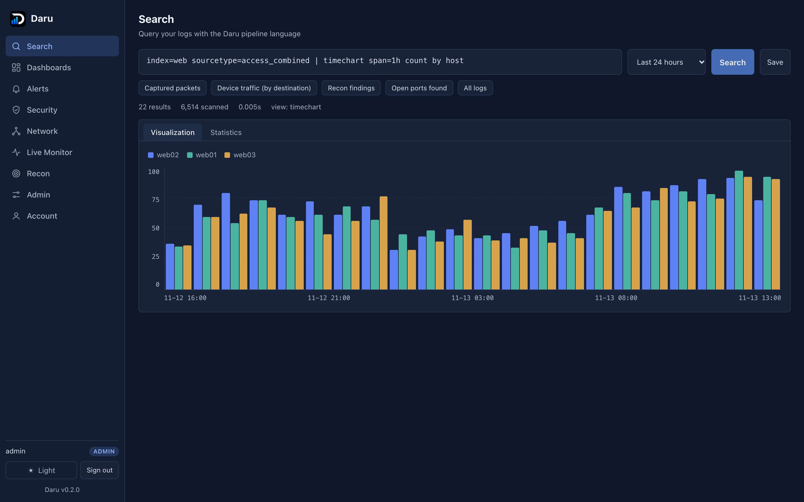
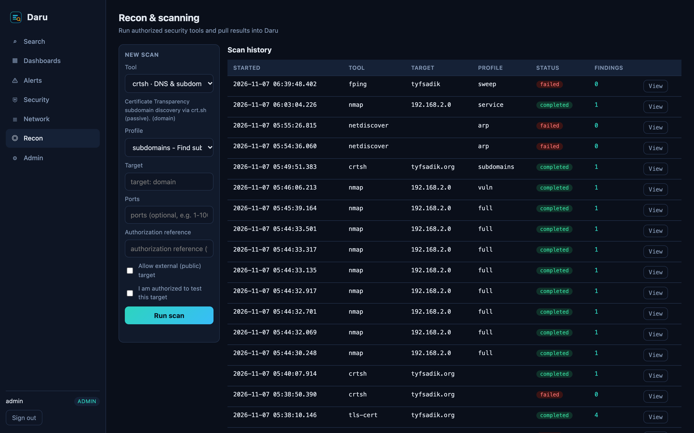
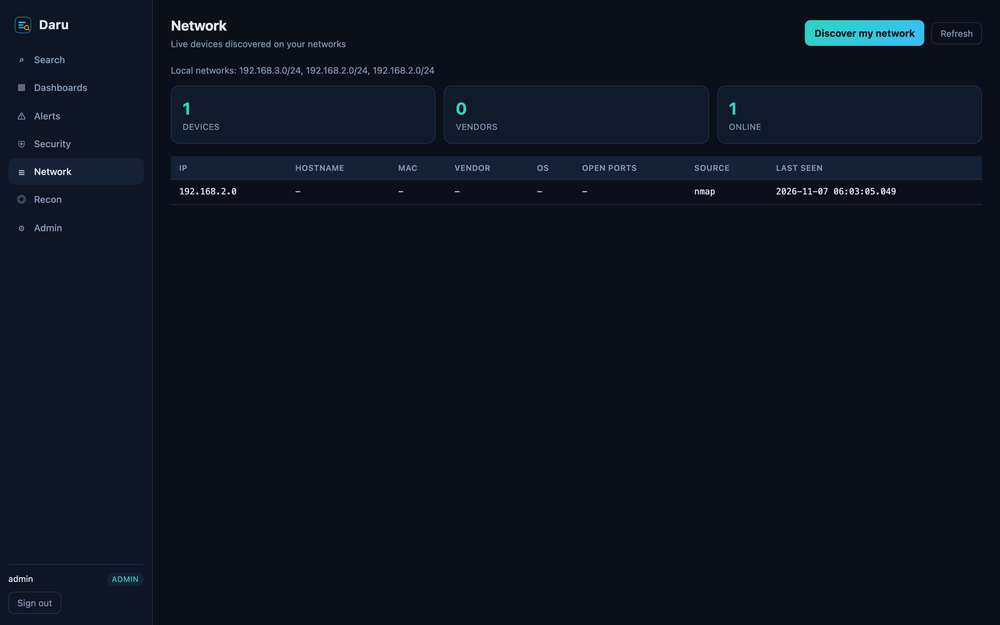
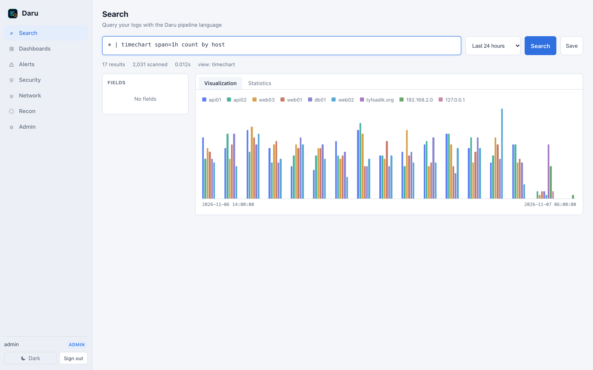
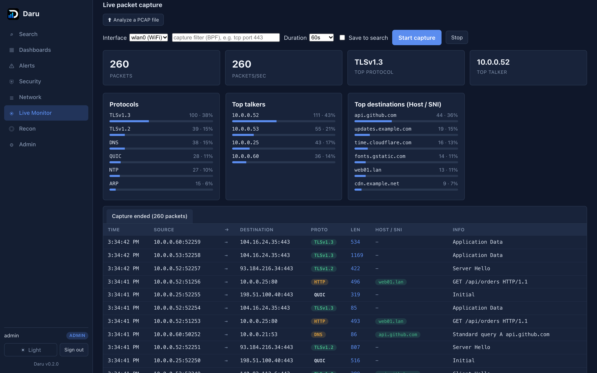
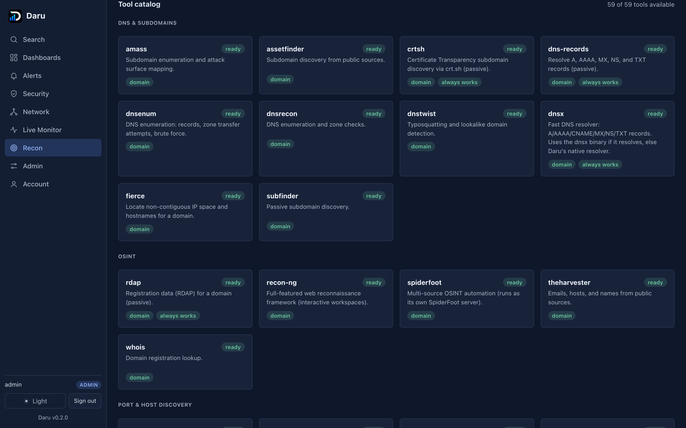
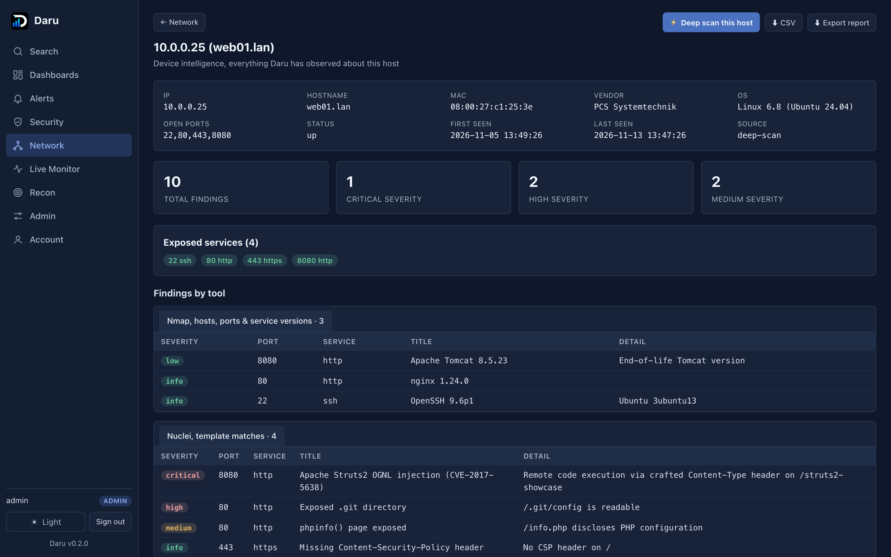
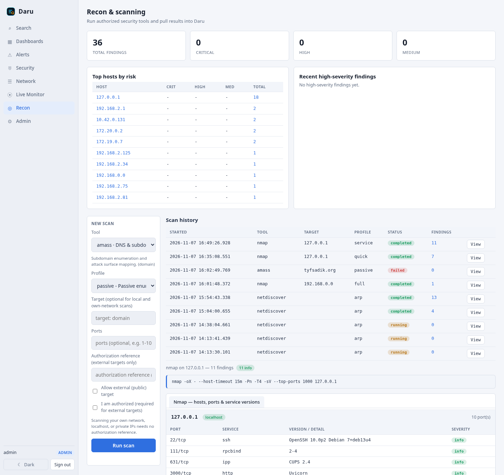

<div align="center">


# Daru

**Self-hosted log analytics and SIEM in a single Go binary, plus ClickHouse.**

Splunk-style search, dashboards, scheduled alerts, incident triage, and
authorized recon tooling. No API keys. No cloud. No per-GB licensing.

[](https://github.com/TYFSADIK/daru/actions/workflows/ci.yml)
[](https://github.com/TYFSADIK/daru/releases)
[](https://go.dev)
[](LICENSE)
[](#platform-notes)
[](CONTRIBUTING.md)
[](https://github.com/TYFSADIK/daru/stargazers)

[Install](#install-one-command) . [Query language](#query-language) . [Screenshots](#screenshots) . [Recon](#recon) . [Contributing](CONTRIBUTING.md)

</div>

---

## Why Daru

Most teams want what Splunk does without the bill, the cloud dependency, or the
API keys. Daru is a single Go binary that collects logs, stores them in
ClickHouse (a required second service, run via Docker or natively), and lets you search them with a pipe query language, build
dashboards, run scheduled alerts, triage notable events, and drive authorized
security tools, all on hardware you control.

- **One binary.** Search API, ingest endpoints, alert scheduler, and web UI are
  compiled into a single executable. The only other piece is ClickHouse.
- **Drop-in ingest.** The HTTP endpoint speaks Splunk HEC, so forwarders already
  pointed at HEC work unchanged. Raw and JSON are accepted too. Note: Daru has
  no indexer acknowledgement (ack) endpoint, so Splunk forwarders that require
  ack will not work; use HEC without ack, or raw and JSON ingest.
- **A real query language.** `search`, `where`, `eval`, `stats`, `timechart`,
  `chart`, `top`, `rare`, `rex`, `spath`, `sort`, `dedup`, `rename`, `bin`,
  `fillnull`, `eventstats`, `streamstats`, and more, compiled to ClickHouse SQL.
- **Runs anywhere.** Linux, macOS, Windows, Raspberry Pi, and Android (Termux).
  See [Platform notes](#platform-notes): Android cannot run ClickHouse
  locally, Windows recon tooling is mostly Linux-only, and Pi needs a 64-bit
  OS with 4 GB+ RAM.
- **No API keys, no telemetry.** Your logs never leave your machines, except
  that Daru's native collectors call crt.sh, DNS, and RDAP over the internet
  for certificate-transparency, DNS, and TLS lookups. Those are the only
  external services Daru contacts.

## Screenshots

**Search with the Daru pipeline language and live charts:**



**Recon and scanning, with an authorization gate on every scan:**



**Live network device discovery:**



**Light theme, one click away:**



**Live Monitor, real-time packet capture with a Host/SNI column, protocol
breakdown, top talkers, and the domains each device is contacting (no root or
wireshark group needed; captures via tcpdump and decodes with tshark):**



**Per-tool dashboards, every one of the 51 recon tools has its own dashboard
and a catalog card showing availability:**



**Per-device intelligence, everything Daru has observed about a host
(identity, OS, open ports, every finding from every tool), with HTML and CSV
report export:**



**Security posture overview, findings by severity, top hosts by risk, and
recent high-severity findings across all scans:**



## Live Monitor

The **Live Monitor** section turns Daru into a lightweight network observability
console, all read live from the kernel and your capture tools:

- **Interfaces & WiFi**, per interface: type, IP, MAC, link speed, and for
  WiFi the SSID, band, signal quality, link rate, and live throughput.
- **Live packet capture**, start an in-browser capture on any interface and
  watch decoded packets stream in a Wireshark-style table: source/destination,
  protocol, length, and a **Host/SNI** column showing the TLS SNI, DNS query, or
  HTTP host per packet. Live **protocol breakdown**, **top talkers**, and **top
  destinations** panels update every second. Capture works without root or
  wireshark-group membership: Daru captures with `tcpdump` (which carries
  `CAP_NET_RAW`) and decodes the stream with `tshark`, so you get full
  application-layer detail (DNS/TLS-SNI/HTTP) live.

## God-mode orchestrators

Two one-click actions fuse several tools into a single aggregated result:

- **Deep scan** (Network tab), discovery + nmap OS/service detection + NetBIOS
  names merged into a full device profile per host on your LAN.
- **Web assessment** (`web-recon`), HTTP probe + technology fingerprint +
  content discovery (and nuclei templates on the full profile) against a URL,
  with each finding tagged by its source tool.

## Install (one command)

Daru runs on Linux, macOS, Raspberry Pi, Windows, and Android (Termux).

**Linux, macOS, Raspberry Pi, Termux:**

```bash
git clone https://github.com/TYFSADIK/daru
cd daru
./install.sh
```

To also install the security scanners (nmap, masscan, nuclei, and the rest) in
the same step, add `--with-tools`:

```bash
./install.sh --with-tools
```

By default the installer sets up only Daru itself. The scanners are dual-use
tools that need your package manager and root, so they are opt-in: either pass
`--with-tools` above or run `./scripts/install-recon-tools.sh` later.

**Windows (PowerShell):**

```powershell
git clone https://github.com/TYFSADIK/daru
cd daru
powershell -ExecutionPolicy Bypass -File install.ps1
```

The installer builds Daru (installing a Go toolchain if you do not have one),
starts ClickHouse with Docker if it is available, generates admin and database
passwords into `~/.daru/daru.env`, and prints your login. Then:

```bash
set -a; . ~/.daru/daru.env; set +a
daru serve
```

Open http://localhost:8088 and sign in as the `admin` user printed by the
installer.

### Platform notes

- **Raspberry Pi**: use a 64-bit OS with 4 GB+ RAM; ClickHouse runs natively on
  arm64.
- **Android (Termux)**: the Daru binary runs, but ClickHouse does not run on
  Android. Point Daru at a ClickHouse on another machine with
  `DARU_CLICKHOUSE_URL=http://<host>:8123`.
- **Windows**: the Daru binary and the web UI run, but most recon tooling
  (nmap, masscan, tcpdump, tshark, arp-scan) is Linux-only, so Recon and Live
  Monitor are limited on Windows.
- **Raspberry Pi**: use a 64-bit OS with 4 GB+ RAM; ClickHouse runs natively on
  arm64.
- **No Docker?** Install ClickHouse natively (its official installer is
  `curl https://clickhouse.com/ | sh`), or point `DARU_CLICKHOUSE_URL` at an
  existing instance.

### Prebuilt binaries

Each release publishes static binaries for every platform (`make release`
builds them locally into `dist/`). Download the one for your system, drop it on
your `PATH`, and run `daru serve`.

## Features

- **Collect** logs over HTTP in the Splunk HEC format, as raw text, or as JSON.
  Fields are pulled out automatically from `key=value` pairs and JSON.
- **Search** with a pipe language and see results as tables, time charts, and
  bar charts, with a field sidebar for quick drill-down.
- **Dashboards** of saved panels, with a share link per dashboard
  (`#/dashboard/<id>`), Export PDF via the browser print dialog, and Export
  CSV (one section per panel).
- **Scheduled reports**: any saved search can be scheduled as an alert from
  the Search page (cron, condition, severity, optional webhook URL stored
  with the alert). A dashboard can be printed or exported to CSV on demand.
- **MITRE ATT&CK coverage**: the Security page groups notable events by
  MITRE tactic from the `mitre` field, with unmapped events shown separately.
- **Alerts**: scheduled searches on a cron schedule, with a condition and
  severity. A firing can open a notable event. For reporting queries
  (`stats count by host`) the condition is checked against the total across
  every group. Webhooks are signed with HMAC-SHA256 when
  `DARU_WEBHOOK_SECRET` is set (see [Webhook signatures](#webhook-signatures)).
- **Security**: a notable-event queue for incident triage, with status and
  owner.
- **Accounts**: built-in users with Argon2id password hashing, roles (admin,
  power, user), TOTP second factor, and revocable sessions. No external
  identity provider needed, and optional **LDAP / Active Directory**,
  **OIDC**, and **SAML 2.0** sign in when you have one (see
  [Single sign on](#single-sign-on-oidc)). Each account has a sign in
  method, and an external identity can only sign in to an account of its
  own method, so a directory or IdP user can never take over a local
  account with the same name.
- **Per-index access control**: each user can be limited to a set of indexes
  (**Admin > Users > Indexes**, or `POST /api/admin/users/{name}/indexes`).
  Searches, the index list, and that user's scheduled alerts only read the
  permitted indexes. Admins always read every index.
- **Retention**: per-index retention in days (up to 3650), enforced by a sweep that drops
  expired day partitions every 6 hours, independent of the alert scheduler.
- **Limits**: a global ingest rate limit (events per second) plus per user
  quotas on running scans, scans per hour, and scheduled scans.
- **Operations**: `/api/health` (liveness), `/ready` (ClickHouse reachable),
  and `/metrics` (Prometheus text format).
- **Recon**: run authorized security tools (nmap, masscan, naabu, zmap, nbtscan,
  nuclei, nikto, httpx, whatweb, gobuster, ffuf, katana, sqlmap, subfinder,
  amass, dnsenum, fierce, sslscan, testssl, smbmap, enum4linux, snmpwalk,
  tshark, and more) and native collectors (crt.sh, DNS, TLS, RDAP) and pull
  their structured findings into search.
- **Network**: discover live devices on your LAN with IP, hostname, MAC,
  vendor, and OS. One-click **deep scan (god mode)** fuses discovery, nmap
  OS/service detection, and NetBIOS names into a full profile per device.
- **Live Monitor**: real-time per-interface and WiFi link stats (SSID, band,
  signal, link rate, live throughput) plus an in-browser **packet capture**
  that streams decoded packets (source/destination, protocol, ports, DNS
  queries, TLS SNI, HTTP host) with live protocol, top-talker and
  top-destination breakdowns. Capture works without root or wireshark-group
  membership, and captured packets can be **saved to a searchable index**.
- **Offline PCAP analysis**: upload a `.pcap`/`.pcapng` and decode it with the
  same tshark rich decoder (DNS/TLS-SNI/HTTP), no capture permission needed.
- **Per-tool dashboards**: every recon tool has its own dashboard at
  `#/tool/<name>` with its description, profiles, a run panel, and its own
  scan history and results, plus a catalog card showing availability.
- **Per-device intelligence**: click any device to see everything observed
  about it (identity, OS, open ports, every finding from every tool), with
  one-click deep-rescan and **HTML report + CSV export**.
- **Security posture overview**: findings by severity, top hosts by risk, and
  recent high-severity findings aggregated across all scans.
- **Scheduled scans**: run any recon tool on a cron schedule for continuous
  monitoring; results feed the inventory and posture automatically.
- **Web assessment orchestrator** (`web-recon`): one action fuses HTTP probe,
  technology fingerprint, content discovery, and template-based vuln scanning
  against a URL.
- **Resilient tooling**: tools with a native equivalent (SMB enumeration, DNS
  resolution, LAN discovery, certificate-transparency and TLS/RDAP lookups)
  always return results via a built-in engine when the external binary is
  missing or cannot run in the environment.

## Query language

A query is a series of commands joined by `|`. The first command is a search
over the raw text and extracted fields; later commands transform the results.

```
index=web status>=500 host=api*
  | eval slow = if(latency_ms > 500, "yes", "no")
  | stats count, avg(latency_ms) as avg_ms by host, slow
  | sort -count
```

A few more to try once you have data:

```
* | timechart span=1h count by host
status=500 | stats count by host
* | top url
sourcetype=api_json | stats avg(latency_ms) as avg_latency by user | sort -avg_latency
```

Time ranges use forms like `-15m`, `-24h`, `-1d@d` (snap to the start of the
day), epoch seconds, or ISO timestamps.

## Recon

Daru can drive standard, dual-use security tools and pull their findings into
search. Every scan is gated: it requires an **authorization reference** and an
explicit **"I am authorized to test this target"** confirmation, and a scope
guard blocks public targets unless you opt in and refuses overly broad ranges.
Each tool runs only when its binary is present on the host.

Install the optional scanners (consent-gated) with:

```bash
./scripts/install-recon-tools.sh
```

This installs discovery, vulnerability, web, DNS/OSINT, and traffic-analysis
tools. It deliberately installs no denial-of-service tools, no mass
auto-exploiters, and no anti-virus evasion tooling.

### Network discovery and privileges

The **Network** tab finds live devices on your LAN. For a complete picture
(including silent devices like phones, printers, and IoT that answer no TCP),
Daru uses `arp-scan`, which sends real ARP requests. Without it, Daru falls
back to a TCP sweep plus the OS ARP table, which only finds hosts with an open
port.

`arp-scan`, `nmap` SYN/ARP scans, `masscan`, and packet capture need the
`CAP_NET_RAW` capability. The right way to grant it is per-binary file
capabilities, **not** running Daru as root. Do that once with:

```bash
sh scripts/grant-capabilities.sh
```

This grants only the raw-socket capability to those specific tools, so they
work for your normal user while Daru itself keeps running unprivileged. The
`--with-tools` installer runs this step for you.

#### Local root mode

On a private box that no one else can reach, you may prefer to just run
everything as root so every tool works with no per-tool setup:

```bash
sh scripts/serve-root.sh
```

This loads `~/.daru/daru.env` and runs `daru serve` under `sudo -E`. Because
`SUDO_USER` is preserved, Daru still finds tools you installed in your own
`~/go/bin` and `~/.local/bin`.

Only do this on a local, non-public instance. Running as root means anyone who
can reach this Daru can run root commands through it, so keep it bound to
localhost or a trusted LAN:

```bash
# in ~/.daru/daru.env, to accept only local connections:
DARU_LISTEN=127.0.0.1:8088
```

For a shared or internet-exposed instance, use `grant-capabilities.sh` above
and run Daru as a normal user instead.

## Run with Docker Compose

```bash
cd deploy
export CLICKHOUSE_PASSWORD=$(openssl rand -hex 16)      # ClickHouse schema user
export CLICKHOUSE_APP_PASSWORD=$(openssl rand -hex 16)  # least privilege app user
export DARU_ADMIN_PASSWORD=$(openssl rand -hex 16)      # Daru admin login
docker compose up -d
```

Open http://localhost:8088 and sign in with the admin account you set in
`DARU_ADMIN_USER` and `DARU_ADMIN_PASSWORD`.

ClickHouse privileges are split. Daru runs as `daru_app`, which has only
`SELECT`, `INSERT`, and row level `ALTER DELETE`/`ALTER UPDATE`, and uses the
`daru` ClickHouse user only for schema migrations and retention partition
drops. User written searches also run with ClickHouse `readonly=2`. The app
user is created on the first start by
`deploy/clickhouse-init/10-daru-users.sh`. For an existing ClickHouse volume,
or a ClickHouse you run yourself, apply `deploy/clickhouse-users.sql` once and
set `DARU_CLICKHOUSE_ADMIN_USER`.

Send some sample logs:

1. In the UI, go to **Admin > Ingest tokens** and create a token. Copy it.
2. Run the generator:

   ```bash
   python3 examples/sendlogs.py --server http://localhost:8088 --token YOUR_TOKEN --count 2000
   ```

3. Go to **Search** and run a query.

## Backup and restore

All Daru state lives in ClickHouse, so back it up with:

```bash
./scripts/backup.sh
# writes ~/.daru/backups/daru-YYYY-MM-DD-HHMMSS.tar.gz (readable by you only)
```

Check a backup and restore it with:

```bash
./scripts/restore.sh --dry-run ~/.daru/backups/daru-2026-11-08-030000.tar.gz
./scripts/restore.sh ~/.daru/backups/daru-2026-11-08-030000.tar.gz
```

The scripts use ClickHouse's HTTP interface (only `curl` 7.87+ and `tar`
are needed), so they work with ClickHouse in Docker or on another host and
need no server side backup configuration. The file holds each table's
schema and rows. It includes password, session, and token hashes, so keep
it private.

Restore replaces every table in the backup, so stop Daru first and back up
the current data if it matters. It needs schema rights: set
`DARU_CLICKHOUSE_ADMIN_USER` and `DARU_CLICKHOUSE_ADMIN_PASSWORD` (backup
works with the least privilege app user too). Test a restore on a scratch
ClickHouse before relying on it. Daily cron example:

```cron
0 3 * * * /path/to/daru/scripts/backup.sh >> /var/log/daru-backup.log 2>&1
0 4 * * * find "$HOME/.daru/backups" -name 'daru-*.tar.gz' -mtime +7 -delete
```

The scripts read `DARU_CLICKHOUSE_URL`, `DARU_CLICKHOUSE_DB`, the app and
admin ClickHouse users and passwords, and `DARU_BACKUP_DIR`, and load
`~/.daru/daru.env` when present.

## TLS

Daru serves plain HTTP by default on `:8088`. Do not expose that directly.
Put a reverse proxy with TLS in front of it (Caddy, nginx, or Traefik), set
`DARU_SECURE_COOKIES=true`, and bind Daru to localhost
(`DARU_LISTEN=127.0.0.1:8088`) unless the proxy runs on another host. The
version shown in the UI footer is stamped by `make stamp-version` at release
time; the binary version comes from `git describe --tags` via the Makefile.

## Running without Docker

You need Go 1.27.4+ and a reachable ClickHouse.

```bash
go build -o daru ./cmd/daru
export DARU_CLICKHOUSE_URL=http://127.0.0.1:8123
export DARU_CLICKHOUSE_USER=default
export DARU_CLICKHOUSE_PASSWORD=yourpassword
./daru useradd -u admin -p 'a-strong-password' -role admin
./daru serve
```

## Sending logs

The HEC endpoint accepts the same JSON shape as Splunk's HTTP Event Collector:

```bash
curl http://localhost:8088/services/collector \
  -H "Authorization: Splunk YOUR_TOKEN" \
  -d '{"event":"user=alice action=login status=200","sourcetype":"app","host":"web01"}'
```

Raw lines (one event per line):

```bash
curl http://localhost:8088/services/collector/raw?sourcetype=syslog \
  -H "Authorization: Splunk YOUR_TOKEN" \
  --data-binary @/var/log/syslog
```

## Configuration

| Variable | Default | Meaning |
|---|---|---|
| `DARU_LISTEN` | `:8088` | Listen address |
| `DARU_CLICKHOUSE_URL` |  `http://127.0.0.1:8123` | ClickHouse HTTP URL |
| `DARU_CLICKHOUSE_DB` | `daru` | Database name |
| `DARU_CLICKHOUSE_USER` | `default` | ClickHouse app user (`SELECT`, `INSERT`, `ALTER DELETE`, `ALTER UPDATE`) |
| `DARU_CLICKHOUSE_PASSWORD` | | ClickHouse app password |
| `DARU_CLICKHOUSE_ADMIN_USER` | app user | ClickHouse user for migrations and retention drops |
| `DARU_CLICKHOUSE_ADMIN_PASSWORD` | | Password for the admin user |
| `DARU_ADMIN_USER` | | Bootstrap admin, created on first run |
| `DARU_ADMIN_PASSWORD` | | Bootstrap admin password |
| `DARU_SECURE_COOKIES` | | Set to `true` behind HTTPS |
| `DARU_WEBHOOK_SECRET` | | HMAC key (16+ chars) for signing alert webhooks |
| `DARU_METRICS_TOKEN` | | Bearer token (16+ chars) for `/metrics`; unset means loopback only |
| `DARU_INGEST_MAX_EPS` | `50000` | Ingest events per second for the deployment, `-1` disables |
| `DARU_REPLICAS` | `1` | Daru servers sharing one ClickHouse; each enforces its share of the ingest limit |
| `DARU_SCAN_CONCURRENT_PER_USER` | `2` | Running recon scans per user, `-1` disables |
| `DARU_SCAN_PER_HOUR_PER_USER` | `30` | Recon scans started per user per hour, `-1` disables |
| `DARU_SCHEDULES_PER_USER` | `20` | Scheduled scans owned per user, `-1` disables |
| `DARU_OIDC_ISSUER` | | OIDC issuer URL; setting it enables single sign on |
| `DARU_OIDC_CLIENT_ID` / `DARU_OIDC_CLIENT_SECRET` | | OIDC client credentials |
| `DARU_OIDC_REDIRECT_URL` | | `https://<host>/api/oidc/callback` |
| `DARU_OIDC_USERNAME_CLAIM` | `email` | `email`, `preferred_username`, or `sub` |
| `DARU_OIDC_ALLOWED_DOMAINS` | | Comma list of email domains allowed to sign in |
| `DARU_OIDC_AUTO_CREATE` | `false` | Create accounts on first SSO sign in |
| `DARU_OIDC_DEFAULT_ROLE` | `user` | Role for auto created accounts |
| `DARU_OIDC_DEFAULT_INDEXES` | none | Index access for auto created accounts (`*` or a list) |
| `DARU_LDAP_URL` | | `ldaps://host:636`; setting it enables directory sign in |
| `DARU_LDAP_BIND_DN` / `DARU_LDAP_BIND_PASSWORD` | | Service account for user lookups |
| `DARU_LDAP_BASE_DN` / `DARU_LDAP_USER_FILTER` | / `(uid=%s)` | Where and how users are found |
| `DARU_LDAP_STARTTLS` / `DARU_LDAP_CA_FILE` | | StartTLS on `ldap://`; CA bundle for the directory |
| `DARU_LDAP_ADMIN_GROUP` / `DARU_LDAP_POWER_GROUP` | | Group DNs mapped to roles |
| `DARU_SAML_ROOT_URL` | | Daru's public URL; setting it enables SAML |
| `DARU_SAML_IDP_METADATA_URL` / `_FILE` | | IdP metadata |
| `DARU_SAML_SP_KEY` / `DARU_SAML_SP_CERT` | | SP key pair (PEM) |
| `DARU_SAML_USERNAME_ATTR` / `DARU_SAML_GROUP_ATTR` | NameID / `groups` | Identity attributes |
| `DARU_SAML_ADMIN_GROUP` / `DARU_SAML_POWER_GROUP` | | Group values mapped to roles |

### Health, readiness, and metrics

- `GET /api/health`: liveness. 200 while the process answers.
- `GET /ready`: readiness. 200 only when ClickHouse answers within 2 seconds,
  otherwise 503. Use it for load balancer and Kubernetes readiness checks.
- `GET /metrics`: Prometheus text format: requests by route and status class,
  ingest events accepted and rate limited, searches and search errors, scans
  started, quota rejections, login failures, running scans, readiness, uptime,
  goroutines, and heap. Without `DARU_METRICS_TOKEN` it answers loopback
  clients only; with it, send `Authorization: Bearer <token>`.

### Single sign on (OIDC)

Daru signs users in through any OpenID Connect provider (Google, Microsoft
Entra ID, Okta, Keycloak, Authentik, Dex, and others) using the authorization
code flow with PKCE. ID tokens are verified locally against the provider's
keys (RS256 or ES256), including issuer, audience, expiry, and nonce.

```bash
export DARU_OIDC_ISSUER=https://accounts.example.com
export DARU_OIDC_CLIENT_ID=daru
export DARU_OIDC_CLIENT_SECRET=...
export DARU_OIDC_REDIRECT_URL=https://daru.example.com/api/oidc/callback
export DARU_OIDC_ALLOWED_DOMAINS=example.com   # optional email domain allowlist
```

Register the redirect URL with your provider. The login page then shows
**Sign in with SSO**. By default an SSO identity can sign in only when an
admin has already created a Daru account with the matching username (the
verified email, or set `DARU_OIDC_USERNAME_CLAIM=preferred_username`). With
`DARU_OIDC_AUTO_CREATE=true`, accounts are created on first sign in with
`DARU_OIDC_DEFAULT_ROLE` (default `user`) and `DARU_OIDC_DEFAULT_INDEXES`
(default: no index, so an admin grants access explicitly). Multi factor
authentication is the provider's job for SSO sign ins.

### LDAP and Active Directory

The normal password form checks local accounts first, then the directory.
Daru binds as a service account, finds the user, and binds as the user with
the typed password. Connections must be TLS (`ldaps://`, or StartTLS);
plain LDAP is refused except to loopback with `DARU_LDAP_INSECURE=true`.
Empty passwords are refused before contacting the server, and the username
is filter escaped.

```bash
export DARU_LDAP_URL=ldaps://dc.example.com:636
export DARU_LDAP_BIND_DN="cn=daru,ou=service,dc=example,dc=com"
export DARU_LDAP_BIND_PASSWORD=...
export DARU_LDAP_BASE_DN="ou=people,dc=example,dc=com"
export DARU_LDAP_USER_FILTER="(uid=%s)"          # AD: (sAMAccountName=%s)
export DARU_LDAP_ADMIN_GROUP="cn=daru-admins,ou=groups,dc=example,dc=com"   # optional
export DARU_LDAP_POWER_GROUP="cn=daru-power,ou=groups,dc=example,dc=com"    # optional
```

With group DNs set, the role follows group membership at every sign in.
Daru TOTP still applies to directory accounts that enrol in it.

### SAML 2.0

Daru is a SAML service provider (HTTP-Redirect requests, HTTP-POST
responses). Responses must be signed by the IdP (SHA-1 refused), are
checked for audience, destination, InResponseTo, and validity, are tied to
the browser that started the sign in, and cannot be replayed. IdP initiated
sign in is refused.

```bash
openssl req -x509 -newkey rsa:2048 -nodes -days 730 -subj "/CN=daru-sp" \
  -keyout sp.key -out sp.crt
export DARU_SAML_ROOT_URL=https://daru.example.com
export DARU_SAML_IDP_METADATA_URL=https://idp.example.com/metadata   # or DARU_SAML_IDP_METADATA_FILE
export DARU_SAML_SP_KEY=/etc/daru/sp.key DARU_SAML_SP_CERT=/etc/daru/sp.crt
export DARU_SAML_GROUP_ATTR=groups DARU_SAML_ADMIN_GROUP=daru-admins   # optional
```

Give your IdP the SP metadata from `https://daru.example.com/api/saml/metadata`.
The username is the NameID unless `DARU_SAML_USERNAME_ATTR` names an
attribute. The login page then shows **Sign in with SAML**.

LDAP and SAML take the same account options as OIDC:
`DARU_LDAP_AUTO_CREATE` / `DARU_SAML_AUTO_CREATE` (default off; an admin
creates the account with the matching sign in method under Admin > Users),
`..._DEFAULT_ROLE` (default `user`), and `..._DEFAULT_INDEXES` (default none).

### Webhook signatures

With `DARU_WEBHOOK_SECRET` set, every alert webhook carries:

```
X-Daru-Timestamp: 1800000000
X-Daru-Signature: sha256=<hex HMAC-SHA256(secret, timestamp + "." + raw body)>
```

Recompute the HMAC over the raw request body, compare in constant time, and
reject timestamps more than five minutes old. In Python:

```python
import hmac, hashlib, time
def verify(secret: bytes, ts: str, sig: str, body: bytes) -> bool:
    if abs(time.time() - int(ts)) > 300:
        return False
    want = "sha256=" + hmac.new(secret, ts.encode() + b"." + body, hashlib.sha256).hexdigest()
    return hmac.compare_digest(want, sig)
```

## Architecture

```
  forwarders / apps                 browser
        | HEC / raw / JSON             | HTTPS
        v                              v
  +------------------------- daru (one binary) --------------------------+
  |  ingest  ->  field extraction       search API  ->  Daru query parser |
  |                     |                      |         -> SQL compiler   |
  |  alert scheduler ---+----------------------+                          |
  |  web UI (embedded)  |                      |                          |
  +---------------------+----------------------+--------------------------+
                        v                      v
                     +---------------- ClickHouse ----------------+
                     |  events, users, sessions, saved searches,  |
                     |  dashboards, alerts, notable events        |
                     +--------------------------------------------+
```

## Contributing

Contributions are welcome. See [CONTRIBUTING.md](CONTRIBUTING.md) for how to
build, test, and submit changes. For anything security-related, see
[SECURITY.md](SECURITY.md).

If Daru is useful to you, a star helps other people find it.

## Status

Daru is under active development. Working today: ingest (HEC, raw, JSON), the
query language and compiler, the search UI with charts, saved searches,
dashboards, scheduled alerts, the notable-event queue, user and token
administration, LDAP, OIDC, and SAML sign in, per-index access control and retention, ingest rate limits
and scan quotas, readiness and Prometheus metrics, signed webhooks, the recon
subsystem, and network discovery.

## License

MIT. See [LICENSE](LICENSE). Daru is an independent project and is not
affiliated with or endorsed by Splunk.
