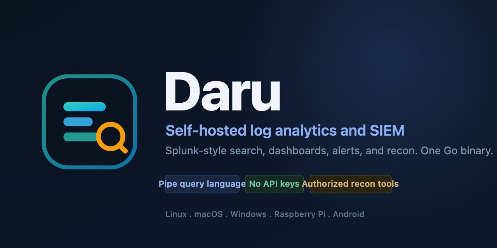

<div align="center">



# Daru

**Self-hosted log analytics and SIEM in a single Go binary.**

Splunk-style search, dashboards, scheduled alerts, incident triage, and
authorized recon tooling. No API keys. No cloud. No per-GB licensing.

[](https://github.com/TYFSADIK/daru/actions/workflows/ci.yml)
[](https://github.com/TYFSADIK/daru/releases)
[](https://go.dev)
[](LICENSE)
[](#install-one-command)
[](CONTRIBUTING.md)
[](https://github.com/TYFSADIK/daru/stargazers)

[Install](#install-one-command) . [Query language](#query-language) . [Screenshots](#screenshots) . [Recon](#recon) . [Contributing](CONTRIBUTING.md)

</div>

---

## Why Daru

Most teams want what Splunk does without the bill, the cloud dependency, or the
API keys. Daru is a single Go binary that collects logs, stores them in
ClickHouse, and lets you search them with a pipe query language, build
dashboards, run scheduled alerts, triage notable events, and drive authorized
security tools, all on hardware you control.

- **One binary.** Search API, ingest endpoints, alert scheduler, and web UI are
  compiled into a single executable. The only other piece is ClickHouse.
- **Drop-in ingest.** The HTTP endpoint speaks Splunk HEC, so forwarders already
  pointed at HEC work unchanged. Raw and JSON are accepted too.
- **A real query language.** `search`, `where`, `eval`, `stats`, `timechart`,
  `chart`, `top`, `rare`, `rex`, `spath`, `sort`, `dedup`, `rename`, `bin`,
  `fillnull`, `eventstats`, `streamstats`, and more, compiled to ClickHouse SQL.
- **Runs anywhere.** Linux, macOS, Windows, Raspberry Pi, and Android (Termux).
- **No API keys, no telemetry, no external services.** Your logs never leave
  your machines.

## Screenshots

**Search with the Daru pipeline language and live charts:**


**Recon and scanning, with an authorization gate on every scan:**


**Live network device discovery:**


**Light theme, one click away:**


## Install (one command)

Daru runs on Linux, macOS, Raspberry Pi, Windows, and Android (Termux).

**Linux, macOS, Raspberry Pi, Termux:**

```bash
git clone https://github.com/TYFSADIK/daru
cd daru
./install.sh
```

To also install the security scanners (nmap, masscan, nuclei, and the rest) in
the same step, add `--with-tools`:

```bash
./install.sh --with-tools
```

By default the installer sets up only Daru itself. The scanners are dual-use
tools that need your package manager and root, so they are opt-in: either pass
`--with-tools` above or run `./scripts/install-recon-tools.sh` later.

**Windows (PowerShell):**

```powershell
git clone https://github.com/TYFSADIK/daru
cd daru
powershell -ExecutionPolicy Bypass -File install.ps1
```

The installer builds Daru (installing a Go toolchain if you do not have one),
starts ClickHouse with Docker if it is available, generates admin and database
passwords into `~/.daru/daru.env`, and prints your login. Then:

```bash
set -a; . ~/.daru/daru.env; set +a
daru serve
```

Open http://localhost:8088 and sign in as the `admin` user printed by the
installer.

### Platform notes

- **Raspberry Pi**: use a 64-bit OS with 4 GB+ RAM; ClickHouse runs natively on
  arm64.
- **Android (Termux)**: the Daru binary runs, but ClickHouse does not run on
  Android. Point Daru at a ClickHouse on another machine with
  `DARU_CLICKHOUSE_URL=http://<host>:8123`.
- **No Docker?** Install ClickHouse natively (its official installer is
  `curl https://clickhouse.com/ | sh`), or point `DARU_CLICKHOUSE_URL` at an
  existing instance.

### Prebuilt binaries

Each release publishes static binaries for every platform (`make release`
builds them locally into `dist/`). Download the one for your system, drop it on
your `PATH`, and run `daru serve`.

## Features

- **Collect** logs over HTTP in the Splunk HEC format, as raw text, or as JSON.
  Fields are pulled out automatically from `key=value` pairs and JSON.
- **Search** with a pipe language and see results as tables, time charts, and
  bar charts, with a field sidebar for quick drill-down.
- **Dashboards** of saved panels.
- **Alerts**: scheduled searches on a cron schedule, with a condition and
  severity. A firing can open a notable event.
- **Security**: a notable-event queue for incident triage, with status and
  owner.
- **Accounts**: built-in users with Argon2id password hashing, roles (admin,
  power, user), and revocable sessions. No external identity provider needed.
- **Retention**: per-index retention in days, enforced by ClickHouse TTL.
- **Recon**: run authorized security tools (nmap, masscan, nuclei, subfinder,
  amass, tshark, and more) and native collectors (crt.sh, DNS, TLS, RDAP) and
  pull their findings into search.
- **Network**: discover live devices on your LAN with IP, hostname, MAC,
  vendor, and OS.

## Query language

A query is a series of commands joined by `|`. The first command is a search
over the raw text and extracted fields; later commands transform the results.

```
index=web status>=500 host=api*
  | eval slow = if(latency_ms > 500, "yes", "no")
  | stats count, avg(latency_ms) as avg_ms by host, slow
  | sort -count
```

A few more to try once you have data:

```
* | timechart span=1h count by host
status=500 | stats count by host
* | top url
sourcetype=api_json | stats avg(latency_ms) as avg_latency by user | sort -avg_latency
```

Time ranges use forms like `-15m`, `-24h`, `-1d@d` (snap to the start of the
day), epoch seconds, or ISO timestamps.

## Recon

Daru can drive standard, dual-use security tools and pull their findings into
search. Every scan is gated: it requires an **authorization reference** and an
explicit **"I am authorized to test this target"** confirmation, and a scope
guard blocks public targets unless you opt in and refuses overly broad ranges.
Each tool runs only when its binary is present on the host.

Install the optional scanners (consent-gated) with:

```bash
./scripts/install-recon-tools.sh
```

This installs discovery, vulnerability, web, DNS/OSINT, and traffic-analysis
tools. It deliberately installs no denial-of-service tools, no mass
auto-exploiters, and no anti-virus evasion tooling.

### Network discovery and privileges

The **Network** tab finds live devices on your LAN. For a complete picture
(including silent devices like phones, printers, and IoT that answer no TCP),
Daru uses `arp-scan`, which sends real ARP requests. Without it, Daru falls
back to a TCP sweep plus the OS ARP table, which only finds hosts with an open
port.

`arp-scan`, `nmap` SYN/ARP scans, `masscan`, and packet capture need the
`CAP_NET_RAW` capability. The right way to grant it is per-binary file
capabilities, **not** running Daru as root. Do that once with:

```bash
sh scripts/grant-capabilities.sh
```

This grants only the raw-socket capability to those specific tools, so they
work for your normal user while Daru itself keeps running unprivileged. The
`--with-tools` installer runs this step for you.

#### Local root mode

On a private box that no one else can reach, you may prefer to just run
everything as root so every tool works with no per-tool setup:

```bash
sh scripts/serve-root.sh
```

This loads `~/.daru/daru.env` and runs `daru serve` under `sudo -E`. Because
`SUDO_USER` is preserved, Daru still finds tools you installed in your own
`~/go/bin` and `~/.local/bin`.

Only do this on a local, non-public instance. Running as root means anyone who
can reach this Daru can run root commands through it, so keep it bound to
localhost or a trusted LAN:

```bash
# in ~/.daru/daru.env, to accept only local connections:
DARU_LISTEN=127.0.0.1:8088
```

For a shared or internet-exposed instance, use `grant-capabilities.sh` above
and run Daru as a normal user instead.

## Run with Docker Compose

```bash
cd deploy
# Change the passwords first.
docker compose up -d
```

Open http://localhost:8088 and sign in with the admin account you set in
`DARU_ADMIN_USER` and `DARU_ADMIN_PASSWORD`.

Send some sample logs:

1. In the UI, go to **Admin > Ingest tokens** and create a token. Copy it.
2. Run the generator:

   ```bash
   python3 examples/sendlogs.py --server http://localhost:8088 --token YOUR_TOKEN --count 2000
   ```

3. Go to **Search** and run a query.

## Running without Docker

You need Go 1.25+ and a reachable ClickHouse.

```bash
go build -o daru ./cmd/daru
export DARU_CLICKHOUSE_URL=http://127.0.0.1:8123
export DARU_CLICKHOUSE_USER=default
export DARU_CLICKHOUSE_PASSWORD=yourpassword
./daru useradd -u admin -p 'a-strong-password' -role admin
./daru serve
```

## Sending logs

The HEC endpoint accepts the same JSON shape as Splunk's HTTP Event Collector:

```bash
curl http://localhost:8088/services/collector \
  -H "Authorization: Splunk YOUR_TOKEN" \
  -d '{"event":"user=alice action=login status=200","sourcetype":"app","host":"web01"}'
```

Raw lines (one event per line):

```bash
curl http://localhost:8088/services/collector/raw?sourcetype=syslog \
  -H "Authorization: Splunk YOUR_TOKEN" \
  --data-binary @/var/log/syslog
```

## Configuration

| Variable | Default | Meaning |
|---|---|---|
| `DARU_LISTEN` | `:8088` | Listen address |
| `DARU_CLICKHOUSE_URL` |  `http://127.0.0.1:8123` | ClickHouse HTTP URL |
| `DARU_CLICKHOUSE_DB` | `daru` | Database name |
| `DARU_CLICKHOUSE_USER` | `default` | ClickHouse user |
| `DARU_CLICKHOUSE_PASSWORD` | | ClickHouse password |
| `DARU_ADMIN_USER` | | Bootstrap admin, created on first run |
| `DARU_ADMIN_PASSWORD` | | Bootstrap admin password |
| `DARU_SECURE_COOKIES` | | Set to `true` behind HTTPS |

## Architecture

```
  forwarders / apps                 browser
        | HEC / raw / JSON             | HTTPS
        v                              v
  +------------------------- daru (one binary) --------------------------+
  |  ingest  ->  field extraction       search API  ->  BQL parser        |
  |                     |                      |         -> SQL compiler   |
  |  alert scheduler ---+----------------------+                          |
  |  web UI (embedded)  |                      |                          |
  +---------------------+----------------------+--------------------------+
                        v                      v
                     +---------------- ClickHouse ----------------+
                     |  events, users, sessions, saved searches,  |
                     |  dashboards, alerts, notable events        |
                     +--------------------------------------------+
```

## Contributing

Contributions are welcome. See [CONTRIBUTING.md](CONTRIBUTING.md) for how to
build, test, and submit changes. For anything security-related, see
[SECURITY.md](SECURITY.md).

If Daru is useful to you, a star helps other people find it.

## Status

Daru is under active development. Working today: ingest (HEC, raw, JSON), the
query language and compiler, the search UI with charts, saved searches,
dashboards, scheduled alerts, the notable-event queue, user and token
administration, per-index retention, the recon subsystem, and network
discovery.

## License

MIT. See [LICENSE](LICENSE). Daru is an independent project and is not
affiliated with or endorsed by Splunk.
